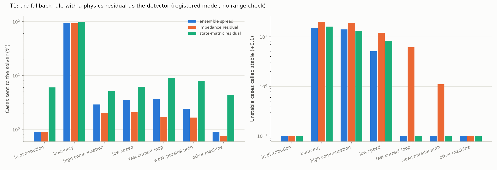
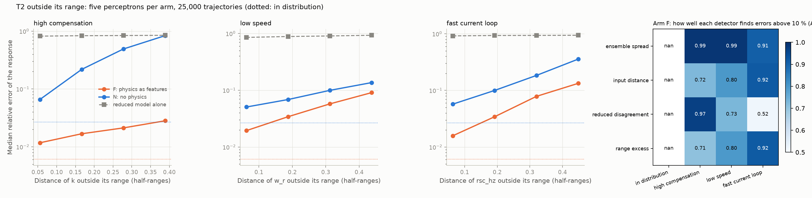

# 48: Outside the range on T2, and a physics-residual detector

Date: 2026-11-16 · Plan phase: 13

## Goal

Step 40 set the fallback rule for T1 with four detectors learned from data and named two gaps: there was no physics-residual detector, and the out-of-distribution study had not been run on T2. This step closes both. On T1 it asks whether a residual of the physics at the predicted eigenvalue tells a wrong prediction better than the ensemble spread. On T2 it measures how the response error grows outside the range, and which detector finds the bad responses.

## What was done

`scripts/phase13_ood_residual.py`.

**T1.** The registered screen of step 42 (version 1.0.0: arm R, five members) predicts a growth rate and a frequency, so an eigenvalue λ̂ = σ̂ + j2πf̂. Two residuals at λ̂:

| Detector | What it is | Cost per case |
|---|---|---|
| impedance residual | \|Z / Z′\| at λ̂ for the loop impedance of the hand calculation (network, machine, current loop): the Newton distance in 1/s from the prediction to a zero of that impedance | 0.30 ms |
| state-matrix residual | the smallest singular value of A(θ) − λ̂I, for the state matrix of the full model; zero when λ̂ is an eigenvalue | 1.84 ms on 8 processes, most of the cost of a solve |

Each replaces the spread in the rule of step 40 (confidence = \|σ̂\| / (detector + floor), floor the median on half the validation fold, threshold × 1.5). No range check, so the outside sets test the detector alone.

**T2.** Five perceptrons with the reduced model's response as inputs (arm F) and five without (arm N), 25,000 trajectories, 16,000 steps. A response is *bad* when its relative error is above 10 %, *very bad* above 25 %. Four detectors: the ensemble spread (relative to the response), the distance to the nearest training cases in the parameters, the disagreement with the reduced model, and how far the parameters are outside their range. A case goes to the solver when its detector is above the smallest value it takes on a very bad validation case, divided by 1.5.

## Commands

```powershell
uv run scripts/phase11_build.py                 # the registered model, if not built
uv run scripts/phase13_ood_residual.py          # about 17 minutes
uv run scripts/phase13_ood_residual.py --reuse
```

## Results

Numbers are in `docs/results/phase13/ood_residual.json`.

### T1: residuals as the detector



Each cell: share sent to the solver, unstable cases called stable. Unstable cases per set as in step 40.

| Set | Ensemble spread | Impedance residual | State-matrix residual |
|---|---|---|---|
| In distribution (1,376 unstable) | 0.89 %, 0 | 0.89 %, 0 | 5.98 %, 0 |
| Boundary (step 08) | 93.8 %, 15 | 93.2 %, 20 | 99.1 %, 16 |
| High compensation | 2.88 %, 14 | 2.00 %, 19 | 5.10 %, 13 |
| Low speed | 3.54 %, 5 | 2.08 %, 12 | 6.18 %, 8 |
| Fast current loop | 3.66 %, 0 | 1.71 %, 6 | 9.04 %, 0 |
| Weak parallel path | 2.42 %, 0 | 1.66 %, 1 | 7.99 %, 0 |
| Other machine | 0.90 %, 0 | 0.76 %, 0 | 4.30 %, 0 |
| Rank correlation with the error, outside sets | 0.32 to 0.60 | 0.31 to 0.59 | −0.03 to 0.24 |

- **Neither residual beats the spread.** In distribution the impedance residual matches it exactly (0.89 %, none missed). Outside, it sends fewer cases to the solver and misses more: 19 against 14 at high compensation, 12 against 5 at low speed, 6 against 0 with a fast current loop.
- **The impedance residual measures distance to the hand calculation's root, not to the true one.** Its zero is where the reduced loop impedance has its root, which step 40 put 1.3 to 3.3 1/s from the solver. Where the model is right and the hand calculation is off, it raises a false alarm; where both are off together, it says nothing.
- **The state-matrix residual barely ranks the errors** (correlation near zero), although it is exact: it is zero only at a true eigenvalue. My reading, not tested: the state matrix is far from normal, so σ_min(A − λI) is small over a wide region round each eigenvalue (its pseudospectrum) and is not a distance in 1/s. It also costs as much as the solver it is meant to avoid.
- **The range check of step 40 stays the guard.** With it, the policy of step 42 misses none.

### T2: outside the range



Median relative error of the response (ensemble mean), and the share of bad responses:

| Set | Arm F | Arm N | Reduced model alone |
|---|---|---|---|
| In distribution | 0.0061 (0 % bad) | 0.027 (0.4 %) | |
| High compensation | 0.019 (2.3 %) | 0.295 (78.7 %) | 0.82 to 0.85 |
| Low speed | 0.040 (20.1 %) | 0.086 (41.0 %) | 0.85 to 0.93 |
| Fast current loop | 0.054 (27.4 %) | 0.141 (63.5 %) | 0.92 to 0.94 |

By quarter of the distance outside the range (first to last quarter), arm F goes from 0.012 to 0.028 at high compensation, 0.019 to 0.091 at low speed and 0.016 to 0.133 with a fast current loop. Arm N goes from 0.066 to 0.837, 0.051 to 0.136 and 0.057 to 0.357.

Detectors for arm F. Each cell: share flagged, very bad responses not flagged / very bad responses.

| Detector | In distribution | High compensation | Low speed | Fast current loop | AUROC for bad, outside |
|---|---|---|---|---|---|
| Ensemble spread | 0.8 %, 0 / 0 | 45.1 %, 0 / 10 | 73.0 %, 0 / 120 | 77.1 %, 0 / 26 | 0.91 to 0.99 |
| Input distance | 1.2 %, 0 / 0 | 87.9 %, 0 / 10 | 88.3 %, 0 / 120 | 89.5 %, 0 / 26 | 0.72 to 0.92 |
| Reduced disagreement | 0.9 %, 0 / 0 | 8.1 %, 0 / 10 | 18.4 %, 31 / 120 | 0.1 %, 26 / 26 | 0.52 to 0.97 |
| Range excess | 0 % | 100 % | 100 % | 100 % | 0.71 to 0.92 |

- **The physics inputs make T2 safe to leave the range a little.** Arm F's error at high compensation (0.019) is below arm N's in distribution (0.027). The reduced model's own error does not grow with distance; arm F inherits part of that.
- **On T2 the ensemble spread works as a detector.** For arm F it flags every response above 25 % error and every one above 10 % (0 of 47, 412 and 562 missed), while flagging 0.8 % in distribution. On T1 it did not (step 40, and the table above). For arm N it misses 2 of 162 very bad responses at low speed, at a higher flagged share.
- **Disagreement with the reduced model is a poor detector** for both arms. The reduced model's own error is 61 % to 94 % on every set (step 47), so its distance from a prediction says little about the prediction.

## Disagreements

1. **The T1 residuals use the predicted frequency as well as the growth rate.** A wrong frequency with a right growth rate raises the residual and costs a solver call. That may be part of why the state-matrix residual flags 6 % in distribution; it was not separated out.
2. **One ensemble per arm on T2,** no repeats. The flagged shares have no intervals.
3. **"Bad" is a choice** (10 % and 25 % of the response). T2's output is a waveform; there is no sign to get wrong, so no analogue of "unstable called stable".

## Decisions

- No physics-residual detector is added to the service. The range check and the spread stay.
- For T2 the rule is: range check, then arm F's ensemble spread. Recorded here; there is no T2 service.

## Next

Step 49: System C as a learned task (done).
