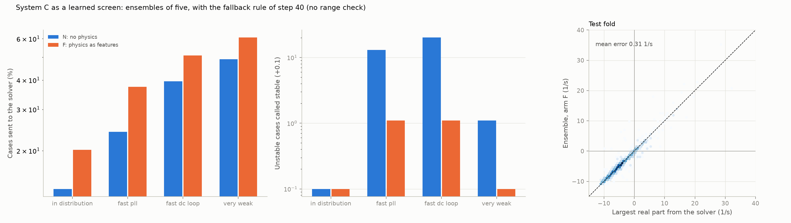

# 49: System C as a learned task

Date: 2026-11-16 · Plan phase: 13

## Goal

System C, the generic grid-following converter of step 17, was used only by the deterministic screens. The report listed it as a learned task not done. This step trains the T1 recipe on it, with and without the impedance scan as inputs, and scores it as a screen with the fallback rule of step 40.

## What was done

`scripts/phase13_system_c.py`, on dataset C1 (step 17). The target is the largest real part of any mode of the converter on its network (1/s). Both families, with and without a phase-locked loop, are pooled, with the family as an input.

| Arm | Inputs |
|---|---|
| N | the 12 parameters and the family |
| F | the same, plus what the converter's 2 × 2 admittance scan against the network gives without solving the model (step 17): the largest loop gain where the converter is not passive, the spectral radius of the loop matrix, the most negative conductance, the highest frequency at which the converter is not passive, the growth rate from the positive-sequence reactance crossing, and the operating point (terminal voltage, reactive current) |

There is no arm R: no quantity available without a solve is close enough to the growth rate to serve as a baseline. The best, the positive-sequence crossing, has a correlation of 0.15 with it.

Each arm is an ensemble of five perceptrons of step 09 (4,000 steps), trained on 32,631 cases with growth rates clipped to ±40 1/s. The rule of step 40 is set on half of the validation fold (2,040 cases, factor 1.5), and applied to the test fold and the three outside sets of step 17, with no range check. Two detectors: none ("margin only": a case is cleared when |σ̂| is above a level in 1/s) and the ensemble spread.

## Commands

```powershell
uv run scripts/phase13_system_c.py           # about 2 minutes on the RTX 3070
uv run scripts/phase13_system_c.py --reuse
```

## Results

Numbers are in `docs/results/phase13/system_c.json`.



| Set (cases, unstable) | MAE N (1/s) | MAE F (1/s) | N, spread: to solver, missed | F, spread: to solver, missed | F, margin only: to solver, missed |
|---|---|---|---|---|---|
| In distribution (4,081, 274) | 0.29 | 0.32 | 13.8 %, 0 | 20.1 %, 0 | 99.6 %, 0 |
| Fast PLL (4,096, 354) | 1.41 | 1.83 | 24.1 %, **13** | 37.4 %, 1 | 95.2 %, 0 |
| Fast DC loop (8,111, 1,887) | 3.08 | 3.04 | 39.5 %, **20** | 50.9 %, 1 | 88.6 %, 0 |
| Very weak network (7,125, 2,207) | 1.16 | 1.11 | 49.0 %, 1 | 60.7 %, 0 | 96.0 %, 0 |

The sign is wrong for 62 (N) and 63 (F) of 4,081 test cases. With the cases ranked by the spread's confidence, the smallest share that misses no unstable test case would be 11.6 % for N and 6.8 % for F; the rule, set on validation with the 1.5 factor, sends more.

- **In distribution, both arms make a working screen.** With the spread, N clears 86 % and F 80 % of cases, and neither misses any of 274 unstable cases.
- **The scan does not make the growth rate easier to predict** (MAE 0.32 against 0.29), but it makes the screen safer outside the range: arm F misses 1, 1 and 0 unstable cases on the three outside sets where arm N misses 13, 20 and 1. My reading: the scan quantities are physics evaluated at the new parameters, so they move with the stability outside the range, where a network fed only the parameters has to extrapolate.
- **Without the spread the margin is useless.** To clear no unstable validation case, the margin must be 10.6 1/s (N) or 16.2 1/s (F), and almost no case is that far from zero.
- **Against the deterministic scan screen of step 24.** That screen, on the same converter with a 1 % scan and the network known to within 10 %, clears 87.8 % of PLL converters and 70.6 % of the others with no unstable case missed in 24,659 cases, and needs no training. Arm F takes the same scan as input. It clears a similar share in distribution (80 % pooled), and outside the range it misses where the deterministic screen does not.

## Disagreements

1. **Not the same cases as step 24.** Step 24 scored its own 24,659 cases, each family separately, with the network uncertain by 10 %. The shares here are on C1's test fold with both families pooled and the network known. They are not paired.
2. **No range check.** With one (step 40), every case of the outside sets goes to the solver and nothing is missed. The table shows the detectors alone.
3. **One ensemble per arm,** no repeats over seeds.

## Decisions

- For System C the recommended screen stays the deterministic scan screen of step 24. A learned model on top of the same scan clears no more in distribution, and outside the range it misses where the deterministic screen does not.

## Next

Step 50: active learning.
