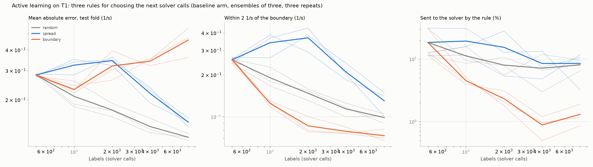

# 50: Active learning

Date: 2026-11-16 · Plan phase: 13

## Goal

Every learned screen so far was trained on cases drawn at random. A label costs one solver call. This step asks whether choosing the next solver calls by the model's own uncertainty reaches a given screen with fewer of them.

## What was done

`scripts/phase13_active.py`, on task T1. The training fold is the pool; a case's label is revealed when it is chosen. Starting from 500 random cases, labels are added in rounds to 1,000, 2,000, 4,000 and 8,000, by three rules:

| Rule | Next cases chosen |
|---|---|
| random | at random |
| spread | where an ensemble of three disagrees most |
| boundary | whose predicted sign is least certain: smallest \|σ̂\| / (spread + floor), the confidence of step 40 |

The model is the baseline arm R of step 09 (perceptron, 2,000 steps), an ensemble of three, refitted each round. It is scored on the test fold (13,105 cases, 1,376 unstable) by its mean absolute error, its error on cases within 2 1/s of the boundary, and as a screen with the fallback rule of step 40 set on half the validation fold. Three repeats with different starting sets.

## Commands

```powershell
uv run scripts/phase13_active.py           # about 10 minutes on the RTX 3070
uv run scripts/phase13_active.py --reuse
```

## Results

Numbers are in `docs/results/phase13/active.json`. Means over three repeats; missed cases are summed over the three (out of 3 × 1,376 unstable).



| Labels | Random: MAE, near boundary, to solver, missed | Spread | Boundary |
|---|---|---|---|
| 500 | 0.28, 0.26, 18.5 %, 1 | (same start) | (same start) |
| 1,000 | 0.21, 0.19, 11.3 %, 0 | 0.32, 0.34, 19.5 %, 0 | 0.23, 0.12, 4.5 %, 1 |
| 2,000 | 0.17, 0.15, 8.0 %, 1 | 0.34, 0.37, 15.5 %, 0 | 0.32, 0.086, 2.3 %, 0 |
| 4,000 | 0.14, 0.11, 7.2 %, 0 | 0.22, 0.21, 8.5 %, 0 | 0.34, 0.079, **0.89 %**, 2 |
| 8,000 | 0.12, 0.10, 8.1 %, 0 | 0.15, 0.13, 8.6 %, 0 | 0.46, 0.073, 1.3 %, 2 |

Share of the labels within 2 1/s of the boundary: 9 % for random, 5 % to 8 % for spread, 53 % to 89 % for boundary.

- **Choosing by the sign's uncertainty cuts the solver calls of the screen eight times.** At 4,000 labels the boundary rule sends 0.89 % of cases to the solver, against 7.2 % for random labels. Step 40 reached 0.72 % with 100,000 random labels and five members. The boundary rule gets close with 4,000, which is 25 times fewer.
- **It does so by giving up the average.** Its mean error rises from 0.23 to 0.46 1/s as the labels pile up near the boundary, while its error near the boundary falls to 0.073 1/s. For a screen that is the right trade: a case far from the boundary is cleared with a large error and the right sign.
- **It is not safe as it stands.** Two unstable cases are called stable at 4,000 and at 8,000 labels, both in one of the three repeats. A likely reason, not tested: the rule's level is set on validation cases drawn at random, while the model was trained on cases that are not.
- **Choosing by the spread alone is worse than random** up to 4,000 labels. It picks cases away from the boundary: 5 % to 8 % of its labels are near it, fewer than at random. A screen does not need those.

## Disagreements

1. **The baseline arm, three members and 2,000 steps,** not the five members and longer training of the service. Rounds are refitted from scratch.
2. **One batch per round,** the top of the ranking taken at once. Batches that spread out over the parameters were not tried.
3. **The misses at 4,000 and 8,000 labels are in one repeat.** Three repeats are not enough to say how often it happens.

## Decisions

- Not adopted for the service. Recorded as the route to a smaller training set if the solver became expensive (a vendor model, for instance): label by the boundary rule, and set the fallback level on a validation set drawn the same way.

## Next

Step 51: a network of many plants with a graph network (done).
