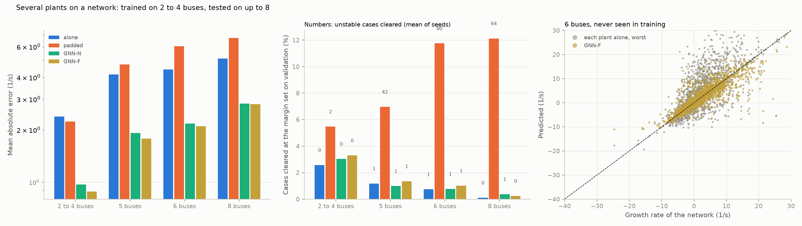

# 51: Several plants on a network, and a graph network

Date: 2026-11-16 · Plan phase: 13

## Goal

Every task so far had one plant. In a real study several plants share a network, and they can interact: one plant's resonance with the line is changed by its neighbour's impedance. The stretch goal was a model that takes the topology as input. This step builds a dataset of trees of plants, trains a message-passing network on small trees, and tests it on larger trees it has never seen, against a plant-by-plant study and a perceptron on a fixed-size input.

## What was done

- `src/sso_sciml/data/grid.py`, dataset G1. A tree of n buses fed from an infinite bus. Each line is R + L (reactance 0.05 to 0.4 pu, X/R 10 to 30) with, half the time, a series capacitor of 20 % to 70 % of the line. At each bus, with probability 0.75, a doubly-fed plant: the current-loop model of step 05 (rotor speed 0.8 to 1.2 pu, current loop 2 to 30 Hz, size 0.2 to 1.0) behind a 0.05 pu transformer. The modes are where the nodal admittance matrix Y(s) is singular, found by Newton's method on det Y from the minima of a scaled |det Y| over 2 to 58 Hz. The truth is the growth rate of the least-damped sub-synchronous mode.
- `src/sso_sciml/models/gnn.py`: a message-passing network in plain PyTorch. Nodes are the buses, the infinite bus included, with the plant's speed, current loop and size; edges are the lines both ways, with reactance, X/R and compensation. Four rounds of messages, width 128, then the maximum and mean over the nodes. The same weights serve a tree of any size.
- `scripts/phase13_grid_gnn.py`: trained on trees of 2 to 4 buses (14,074 cases), tested on trees of 2 to 4, 5, 6 and 8 buses. Four models:

| Model | What it is |
|---|---|
| alone | no training: each plant on the network with every other plant left out, and the worst growth rate taken. What a plant-by-plant study would say |
| padded | a perceptron on the features of up to 8 buses laid side by side, zeros where there is no bus |
| GNN-N | the graph network |
| GNN-F | the same with each plant's growth rate when alone as a node feature: the physics as inputs |

  Three seeds for the learned models, 6,000 steps each. As a screen: the margin set on the validation fold so that no unstable case there is cleared, then the share of test cases cleared at it.
- `tests/test_grid_gnn.py`: 4 tests. One plant on one line gives the root of the loop impedance of step 05; leaving plants out works; the network takes any size and does not depend on the order of the cases in a batch; it trains.

## Commands

```powershell
uv run pytest tests/test_grid_gnn.py
uv run scripts/phase13_grid_gnn.py           # about 50 minutes, most of it generating the data on 8 processes
uv run scripts/phase13_grid_gnn.py --reuse
```

## Results

Numbers are in `docs/results/phase13/grid_gnn.json`. Of the cases drawn, 78 % to 98 % per set had a sub-synchronous mode and a finite plant-alone value, and are kept.

| Set | Cases | Unstable | Median \|network − worst plant alone\| (1/s) |
|---|---|---|---|
| 2 to 4 buses (test) | 2,329 | 54.7 % | 0.92 |
| 5 buses | 1,782 | 60.6 % | 2.76 |
| 6 buses | 1,886 | 61.6 % | 2.98 |
| 8 buses | 976 | 73.4 % | 3.70 |



Mean over three seeds. Each cell: mean absolute error (1/s), share with the sign wrong.

| Model | 2 to 4 buses | 5 buses | 6 buses | 8 buses |
|---|---|---|---|---|
| alone | 2.39, 10.3 % | 4.16, 17.6 % | 4.44, 19.2 % | 5.12, 20.6 % |
| padded | 2.23, 11.0 % | 4.75, 25.5 % | 6.03, 30.8 % | 6.72, 36.1 % |
| GNN-N | 0.97, 4.4 % | 1.92, 10.2 % | 2.17, 11.4 % | 2.83, 12.4 % |
| GNN-F | **0.89, 3.9 %** | **1.78, 9.7 %** | **2.10, 11.6 %** | **2.80, 12.9 %** |

As a screen, cleared share and unstable cases cleared (mean over seeds):

| Model | Margin (1/s) | 2 to 4 buses | 5 buses | 6 buses | 8 buses |
|---|---|---|---|---|---|
| alone | 9.55 | 2.6 %, 0 | 1.2 %, 1 | 0.7 %, 1 | 0.1 %, 0 |
| padded | 4.7 to 15.0 | 5.5 %, 1.7 | 7.0 %, **42** | 11.8 %, **80** | 12.1 %, **64** |
| GNN-N | 8.2 to 8.7 | 3.0 %, 0 | 1.0 %, 1.3 | 0.8 %, 0.7 | 0.4 %, 0.7 |
| GNN-F | 7.4 to 8.6 | 3.3 %, 0 | 1.3 %, 0.7 | 1.0 %, 0.7 | 0.2 %, 0.3 |

- **Plants interact, and more so on larger networks.** The worst plant alone is off the network's growth rate by a median of 0.9 1/s on 2 to 4 buses and 3.7 1/s on 8. A plant-by-plant study gets the sign wrong in 10 % to 21 % of cases.
- **The graph network halves the error of the plant-by-plant study** at every size, including sizes it was not trained on. Its error grows from 0.9 to 2.8 1/s between 2 to 4 and 8 buses; the interaction it has to learn grows too.
- **The fixed-size perceptron does not extrapolate.** On 5 to 8 buses it is worse than the plant-by-plant study, and as a screen it clears 42 to 80 unstable cases per set. Its inputs for bus 6 were zero in every training case.
- **The plant-alone growth rate as an input helps a little** (GNN-F against GNN-N, 0.89 against 0.97 at 2 to 4 buses), and the gap closes on larger trees. It costs 0.088 s per case to compute.
- **None of these is a useful screen on this dataset.** 55 % to 73 % of cases are unstable, and the error is a few 1/s, so the margin that clears no unstable validation case is 7 to 10 1/s and clears 0.1 % to 3.3 %. Even so, the graph networks clear 0.3 to 1.3 unstable cases per set on the larger trees, and the margin would have to grow with network size.

## Disagreements

1. **The plant is the current-loop model** of step 05 (machine, rotor current loop), not the full controls. That is the likely reason most cases are unstable: there is no PLL, outer loop or shaft, and compensation goes up to 70 %.
2. **Trees only.** A meshed network would need loops in the graph; the network takes them, but none were generated.
3. **One mode, the least damped.** Several modes are present in larger trees; tracking each is a different task.
4. **The truth is from the impedance formulation**, which step 05 checked against the state-space model for one plant. For several plants on a tree it is checked only for one plant (the first test).

## Decisions

- The graph network is the form to use if several plants are screened together. For a screen it needs a plant model with the full controls, where the stable share is larger.

## Next

Step 52: the summary of the screening approaches (done, `docs/SCREENING.md`).
